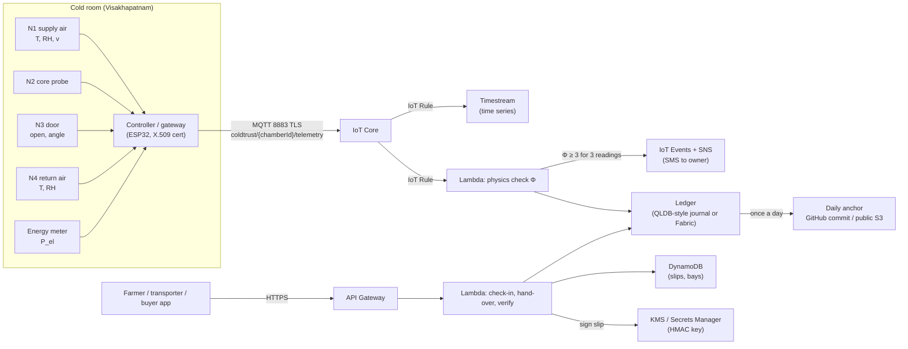

# KoolKisaan Trust & Trade – how it would run in the cloud

The demo runs on one laptop (Python server) or as plain files (Vercel / a USB stick). This page shows how
the same pieces map onto a real cloud deployment. **Nothing here is deployed** – it is the plan.

## Data flow

## Our code → cloud service

| What it does | Our code (demo) | AWS | Azure | Google Cloud |
|---|---|---|---|---|
| HTTPS API for the four roles | `server/app.py` (FastAPI) | API Gateway | API Management | API Gateway / Cloud Endpoints |
| Check-in, hand-over, verify logic | `server/app.py`, `web/trust/trust.js` | Lambda | Functions | Cloud Functions / Cloud Run |
| Slips, bays, capacity rule | browser `localStorage` (demo) | DynamoDB | Cosmos DB | Firestore |
| Sensor messages | `tools/mqtt_simulator.py` (topic `coldtrust/{chamberId}/telemetry`) | IoT Core, MQTT on 8883, X.509 device certificates | IoT Hub (MQTT 8883, X.509) | Pub/Sub + a MQTT broker on GKE (Cloud IoT Core was retired in 2023) |
| Route messages | – | IoT Rule | IoT Hub message routing | Pub/Sub subscription |
| Physics check Φ | `engine/physics_check.py` / `trust_core.js` | Lambda (triggered by the IoT Rule) | Functions / Stream Analytics | Cloud Functions / Dataflow |
| Hash-chain ledger | `engine/trust_ledger.py` (per-slip chain) | QLDB-style journal (QLDB itself is being retired – use DynamoDB + our hash chain, or Hyperledger Fabric on Managed Blockchain) | Azure SQL Ledger tables / Confidential Ledger | Spanner/Firestore + our hash chain, or Fabric on GKE |
| Time-series history | `twin/trust_nodes.py` output | Timestream | Data Explorer | Bigtable / BigQuery |
| HMAC signing key | env var `KOOLKISAAN_HMAC_KEY` (server only) | KMS (HMAC keys) or Secrets Manager | Key Vault | Cloud KMS / Secret Manager |
| Alarms (Φ flag, > 8 °C, freezing) | owner page "Alarms" | IoT Events + SNS (SMS) | Event Grid + Communication Services | Eventarc + Pub/Sub → SMS provider |
| Daily anchor | `trust_ledger.daily_anchor` | Scheduled Lambda → public S3 object + GitHub commit | Function timer → public Blob + GitHub | Cloud Scheduler → public GCS + GitHub |

## What changes in a real deployment

1. **The key.** The demo static version signs in the browser with a public demo key (clearly labelled).
   The server version reads `KOOLKISAAN_HMAC_KEY`. In the cloud the key never leaves KMS: Lambda asks KMS to
   make the HMAC (`GenerateMac`) and to check it (`VerifyMac`).
2. **Who may sign.** The demo's `/api/trust/sign` is open on the local network. In the cloud only the
   cold-store clerk's app may call it (API Gateway + Cognito login, one role per person).
3. **Where the ledger lives.** The demo keeps it in the browser. In the cloud each block is written once to
   an append-only store; the owner's app has read access only.
4. **Sensors sign too.** Each node/gateway gets its own X.509 certificate, so a message cannot be injected
   from outside. That does not stop the owner from wiring a fake sensor – which is why the physics check exists.
5. **The physics check runs on the server**, on every message, and writes the flag into the next block.
   The twin's sensor-noise values (σ) are replaced by values tuned on the first month of real data.
6. **Anchors are public.** Publishing the daily anchor in a place the owner does not control (a public
   GitHub repository, a newspaper notice, a public blockchain transaction) is what makes re-writing a whole
   day detectable.
7. **Offline.** Rural internet drops. The gateway keeps messages (MQTT QoS 1 + local queue) and sends them
   later with the original time stamps; the 5-minute gap check then shows only real gaps.
